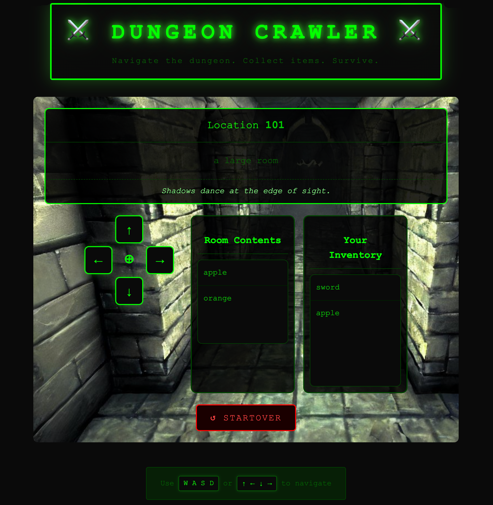

# Dungeon Crawler

[](https://github.com/mrjabba/dungeon-crawler/actions/workflows/tests.yml)

A small text-based adventure game built to practice Angular concepts.



## Game Features

- Navigate through rooms using cardinal directions (North, South, East, West)
- Explore an interconnected world with multiple locations:
  - Starting house
  - Large rooms, hallways, and hidden areas
  - Dining room, study, library, kitchen, and more
- Pick up and collect items as you explore
- Compass-based navigation system

This is a small hobby project for learning and practicing Angular fundamentals including:
- Standalone components
- Angular Material integration
- Reactive forms
- Services and dependency injection
- TypeScript interfaces and enums

## Quick Start

```bash
npm install
npm start
```

Then open http://localhost:4200/ in your browser.

## Documentation

- [Angular Development Guide](docs/angular-dev.md) — Details on running, building, and testing the app
